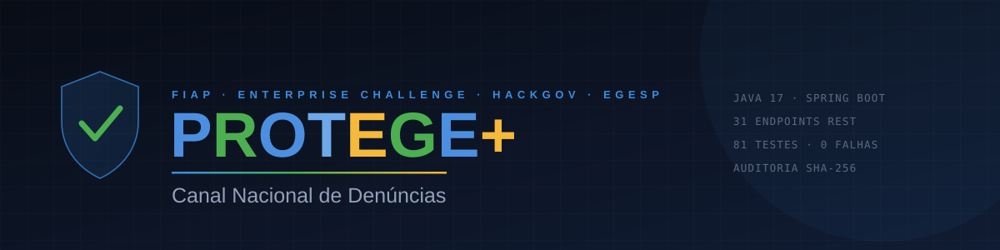

<div align="center">



<br>

[](https://openjdk.org/projects/jdk/17/)
[](https://spring.io/projects/spring-boot)
[](#segurança-e-privacidade)
[](database/01_ddl_oracle.sql)
[](#1-backend-api-java)
[](formulario-react.html)

[](#-testes)
[](#-endpoints)
[](#-dispositivos-de-campo-iot)
[](#-banco-de-dados)
[](#-focos-de-reincidência-estruturas-de-dados)
[](#segurança-e-privacidade)
[](#segurança-e-privacidade)

<br>

[](https://gabriell230g.github.io/ProtegeMais-Fase-6/)
[](https://youtu.be/FHOxDr-g8I8)
[](docs/Protege_Mais_Fase6_Documento.pdf)
[](docs/Protege_Mais_Fase6_Apresentacao.pdf)

<sub>Entregas anteriores: <a href="https://youtu.be/DoenYynHA6E">vídeo da Fase 5</a> · <a href="https://youtu.be/bCIv81vYzPs">vídeo da Atividade 4</a></sub>

</div>

<br>

> ### 🕑 Para avaliar em dois minutos
>
> O site publicado roda **sem servidor**, então mostra apenas 5 denúncias de demonstração e exibe a etiqueta `modo local`.
> Para ver o produto completo, com as **190 denúncias**, os **106 eventos de dispositivos de campo**, os focos de
> reincidência e a trilha de auditoria, suba o backend seguindo a seção [Como executar](#-como-executar). São dois
> comandos e menos de cinco minutos.
>
> **Sem instalar nada:** a tela de login tem o botão **Entrar em modo demonstração** (ou a conta `offline@protege.gov.br` / `offline123`),
> que carrega 125 denúncias direto no navegador. Kanban, backlog, mapa e ficha do caso funcionam. Relatório estatístico,
> trilha de auditoria, dispositivos de campo e focos de reincidência continuam exigindo a API, porque são calculados no servidor.
>
> **Para ver o IoT em funcionamento** sem ter os aparelhos: abra [`simulador-iot.html`](simulador-iot.html) com a API no ar.
> Ele aciona botão de pânico, move uma tornozeleira contra um perímetro real e registra em um totem público.
>
> O documento técnico completo e as apresentações estão em [`docs/`](docs/).

<br>

Plataforma para registro e gestão de denúncias de violência, abuso e violação de direitos, com **canal anônimo para o cidadão** e **painel inteligente para o gestor público**: Kanban, equipe, mapa com k-anonimato, relatório estatístico, trilha de auditoria, o copiloto de IA **VigIA** e, desde a Fase 6, um **barramento de dispositivos de campo** e a **detecção de focos de reincidência**.

Desenvolvido para o **Enterprise Challenge FIAP / HackGov**, em parceria com a **EGESP**. Este repositório é a entrega de código da **Fase 6** da disciplina, e acumula as entregas das fases anteriores e da Atividade 4 do Enterprise Challenge.

---

## 🆕 O que a Fase 6 acrescenta

Até a Fase 5 o sistema inteiro repousava sobre um pressuposto que nunca havia sido examinado: **alguém abre o canal, lê o formulário, escolhe o tipo, escreve o relato e envia.** Esse pressuposto exclui, por construção, três situações em que o canal é mais necessário: quem não pode digitar porque está em risco agora, quem não deveria precisar denunciar porque já existe uma medida protetiva com distância fixada, e quem não tem aparelho, ou tem um aparelho vigiado por quem convive com a vítima.

<table>
<tr>
<td width="33%" valign="top">

#### 📡 IoT

Três origens de campo, **um barramento só**.

- Botão de pânico, tornozeleira e totem público
- Uma tabela com discriminador de origem
- O aparelho relata, **o servidor decide**
- Simulador para operar sem o hardware

</td>
<td width="33%" valign="top">

#### 🗃️ SQL avançado

Seis consultas que **auditam decisões**.

- `ROLLUP` com `GROUPING`, `RANK`, `SUM OVER`, `LAG`
- Subconsulta correlacionada no `HAVING`
- Portáveis entre Oracle e H2, diferenças anotadas
- Resultados reapurados e versionados

</td>
<td width="33%" valign="top">

#### 🧮 Estruturas de dados

Focos de reincidência em **O(k log k)**.

- Árvore balanceada, ordenação, busca binária
- Grafo com busca em largura iterativa
- Só arestas consecutivas: `k-1` em vez de `k(k-1)/2`
- Distingue **surto** de **demanda constante**

</td>
</tr>
</table>

| Indicador | Fase 5 | Fase 6 |
|:--|--:|--:|
| Classes Java de produção | 63 | **79** |
| Endpoints REST | 31 | **38** |
| Testes automatizados | 81 | **136** |
| Tabelas no modelo físico | 12 | **15** |
| Restrições CHECK | 30 | **45** |
| Telas no painel do órgão | 8 | **10** |
| Scripts SQL versionados | 3 | **5** |

O que sustenta a fase não é o crescimento de 25% nas classes de produção. É o crescimento de 68% na suíte de testes.

---

## 📡 Dispositivos de campo (IoT)

Três aparelhos, três regras distintas, **uma tabela só**. A decisão de usar um discriminador de origem em vez de três tabelas paralelas segue o padrão *Single Table Inheritance* (FOWLER, 2002): a pergunta do gestor, "o que chegou de campo hoje?", atravessa as três origens, e uma quarta origem amanhã é uma linha, não uma migração de esquema.

| Origem | Regra | Por quê |
|---|---|---|
| 🆘 **Botão de pânico** | Repique de **120 s** por aparelho | Dois toques dentro da janela são o mesmo pedido, não dois casos. A borda não é repique: 120 s exatos abrem caso novo |
| 📍 **Tornozeleira** | Perímetro do servidor, **600 s** entre alertas | O aparelho envia posição e só. A resposta **não devolve distância nem raio**, porque isso entregaria um mapa do perímetro a quem está sendo monitorado |
| 🏛️ **Totem público** | Repique de **20 s**, relato de **15 a 1200** caracteres | Premissa invertida: numa fila, duas pessoas seguidas são duas pessoas. O totem nunca informa a própria posição, ela vem do cadastro |

A distância é calculada por **Haversine** sobre o raio médio da Terra, e não por Pitágoras: em latitudes brasileiras o erro do plano cartesiano é grande o bastante para decidir errado perto da borda do perímetro.

**Nenhum aparelho envia urgência, classificação ou veredito.** Ele envia fato bruto. Quem classifica é o servidor, e quem lê o texto é o VigIA, exatamente como faz com uma denúncia digitada. Evento aceito que **não** gera caso, como telemetria fora do perímetro, é registrado do mesmo jeito: sem o silêncio gravado não há como provar depois que o equipamento estava reportando.

> ℹ️ O [`simulador-iot.html`](simulador-iot.html) é um **instrumento de teste**, e a própria página diz isso no cabeçalho. Ele ocupa o lugar do aparelho físico que a entrega não tem, e não faz parte do produto.

---

## 🧮 Focos de reincidência (estruturas de dados)

Um `GROUP BY` responde quantas denúncias um município teve. Ele **não** responde se elas formam uma cadeia. Agrupar por chave junta janeiro com dezembro no mesmo balde; agrupar por mês corta a cadeia que atravessa a virada do mês. O vínculo é relacional, não categórico, e por isso é um problema de grafo.

**A regra do elo:** duas denúncias entram na mesma cadeia quando são do mesmo tipo, do mesmo município e estão a no máximo **14 dias** uma da outra. A cadeia só conta a partir de **3** denúncias.

| Etapa | Estrutura | Complexidade |
|---|---|:--:|
| Indexar por data | `TreeMap`, árvore rubro-negra | O(n log n) |
| Recortar a janela | `subMap` | O(log n + k) |
| Ordenar a janela | *merge sort* estável | O(k log k) |
| Localizar o bloco de um grupo | busca binária, *lower bound* | O(log k) |
| Montar o grafo | só pares consecutivos | O(k) |
| Componentes conexos | BFS com `ArrayDeque` | O(V + E) = O(k) |
| **Total por consulta** | | **O(k log k)** |

O detalhe que muda o custo está na montagem do grafo: dentro de um grupo já ordenado por data, **ligar só os vizinhos basta**. Se A liga com B e B liga com C, os três já estão no mesmo componente. Isso reduz as arestas de até `k(k-1)/2` para no máximo `k-1`. Para `k = 160`, a janela de 90 dias da base atual, é a diferença entre cerca de 12,7 mil comparações e 159.

A busca em largura é **iterativa, e não recursiva**: uma cadeia de 10 mil denúncias encadeadas derrubaria a pilha de chamadas.

### O achado: foco não é o mesmo que volume

A tela ficou pronta e mostrou um agrupamento de **49 denúncias** de violência em Barueri no topo da lista. O algoritmo estava certo, elas formam mesmo uma cadeia. Só que aquilo não era um surto: era **tudo que o município produz naquele tipo**. Um foco pede operação pontual; demanda constante pede equipe permanente. São respostas diferentes, e a tela estava chamando as duas de foco.

A correção foi nomear o que o algoritmo encontrou: cobertura de **70% ou mais** do grupo **e** grupo com pelo menos **10** denúncias passam a ser marcados como **fluxo contínuo**. Sobre a base atual, são **7 focos e 2 fluxos contínuos**, e o maior foco caiu de 49 para 7.

---

## 🚀 Como executar

Você precisa apenas de um **JDK 17 ou superior**. O Maven é baixado automaticamente na primeira execução.

> 💡 Use **duas janelas de terminal**: uma para a API e outra para o servidor de arquivos. Se as duas forem a mesma janela, o segundo comando derruba o primeiro.

### 1. Backend (API Java)

```bash
cd backend
.\build.cmd clean test     # Windows, roda os 136 testes
.\build.cmd run            # sobe a API em http://localhost:8080
```

No Linux ou macOS, use o Maven diretamente:

```bash
cd backend
mvn clean test
mvn spring-boot:run
```

<details>
<summary>Gerar o executável</summary>

```bash
.\build.cmd clean package -DskipTests
java -jar target\protege-backend-1.0.0.jar
```

</details>

O banco padrão é o **H2 embutido**, criado automaticamente em `backend/data/`. Não exige instalação, serviço nem credencial, e é o que permite executar o projeto logo após descompactar.

> ⚠️ Se você já tinha executado uma versão anterior, apague `backend/data/` antes de subir: o H2 não recarrega a carga de demonstração sobre um banco que já existe.

| Recurso | Endereço |
|---|---|
| 📘 Documentação da API | <http://localhost:8080/swagger-ui.html> |
| 🗄️ Console do banco | <http://localhost:8080/h2-console> · JDBC `jdbc:h2:file:./data/protege` · usuário `sa`, sem senha |

### 2. Front-end (portal, painel e simulador)

Sirva por HTTP. Abrir o `index.html` com duplo clique faz o navegador bloquear as chamadas por CORS.

```bash
python -m http.server 5500
```

| Tela | Endereço |
|---|---|
| Portal e painel | <http://localhost:5500/index.html> |
| Formulário em React | <http://localhost:5500/formulario-react.html> |
| Simulador de dispositivos | <http://localhost:5500/simulador-iot.html> |

> ⚠️ **A porta importa.** A API aceita apenas `5500`, `5501`, `3000` e `8080` em `localhost`. Em outra porta o navegador bloqueia por CORS. O Live Server do VS Code já usa a 5500.

O front detecta o backend sozinho: se a API estiver no ar, usa o banco; se não, cai para o `localStorage`. O modo ativo não fica implícito, a **etiqueta de conexão** no alto da barra lateral mostra `API conectada` ou `modo local` e é clicável para verificar de novo.

### 3. IA (VigIA com Gemini), opcional

```bash
export GEMINI_API_KEY="sua_chave"     # $env:GEMINI_API_KEY no Windows
```

Sem a chave, o VigIA continua funcionando por regras explicáveis. Cada análise declara sua origem (`GEMINI` ou `REGRAS`), para que a decisão automatizada seja auditável.

---

## 👥 Usuários de demonstração

Criados automaticamente na primeira execução. Existem quatro para que a **segregação de acesso possa ser verificada**, e não apenas descrita.

| | E-mail | Senha | Perfil | Vê identificação | Vê auditoria |
|:---:|---|---|---|:---:|:---:|
| 🔑 | `admin@protege.gov.br` | `admin123` | ADMIN | ✅ | ✅ |
| 🏛️ | `gestor@protege.gov.br` | `gestor123` | GESTOR | ✅ | ❌ |
| 👁️ | `atendente@protege.gov.br` | `atendente123` | ATENDENTE | ❌ | ❌ |
| 🔎 | `auditor@protege.gov.br` | `auditor123` | AUDITOR | ❌ | ✅ |
| 👁️ | `offline@protege.gov.br` | `offline123` | demonstração **sem servidor** | local | local |

O gestor **não** consulta a trilha de auditoria: quem opera o sistema não fiscaliza o próprio uso dele.

---

## 🏗️ Arquitetura

| Camada | Tecnologia | Por quê |
|---|---|---|
| Front-end | HTML, CSS e JavaScript, React via CDN no formulário | Leve, sem build. Integra APIs públicas (IBGE para estados e cidades, OpenStreetMap para geolocalização) |
| Back-end | **Java 17 + Spring Boot 3.3.4** | Padrão de mercado para APIs corporativas e governamentais |
| Banco (demo) | **H2 embutido** | Zero instalação: o projeto roda ao ser descompactado |
| Banco (produção) | **PostgreSQL / Supabase**, modelo físico em **Oracle** | Scripts DDL, carga e consultas em `database/` |
| Dispositivos | REST sobre HTTPS, com cabeçalho `X-Device-Key` | Sem broker MQTT: três origens de baixa frequência não justificam a infraestrutura, e a decisão está declarada no documento |
| Segurança | Spring Security, JWT, BCrypt e RBAC | Perfis reais no token, CORS por lista de origens, limite de requisições por IP |
| Auditoria | Trilha encadeada por SHA-256 | Alteração em qualquer registro invalida a cadeia e é detectada |
| IA | Google Gemini com *fallback* por regras | Sem a chave, o sistema continua funcionando e explicando suas decisões |
| Documentação | Swagger / OpenAPI 3 | O botão *Authorize* permite executar as rotas protegidas pelo navegador |

---

## 🔌 Endpoints

São **38 mapeamentos**. **17** deles estão anotados com `@Auditavel` e alimentam a trilha, inclusive as tentativas recusadas.
🔒 indica que a rota exige o cabeçalho `Authorization: Bearer <token>`.

<details open>
<summary><b>Dispositivos de campo, novo na Fase 6</b></summary>

| Método | Rota | Acesso | Descrição |
|---|---|---|---|
| `POST` | `/api/iot/acionamento` | `X-Device-Key` | Botão de pânico. **201** com o protocolo. Acionamento repetido dentro de 120 s é tratado como repique e vinculado ao mesmo caso |
| `POST` | `/api/iot/telemetria` | `X-Device-Key` | Posição da tornozeleira. **202**, com ou sem violação. A resposta **não** informa distância, raio nem centro do perímetro |
| `POST` | `/api/iot/totem` | `X-Device-Key` | Registro em totem. **201** aceito · **200** repique · **422** recusado, com o código do motivo |
| `GET` | `/api/iot/eventos` | 🔒 | Eventos do barramento, com a decisão do servidor em cada linha. **Leitura auditada** |
| `GET` | `/api/iot/resumo` | 🔒 | Contadores por origem |
| `GET` | `/api/reincidencia/focos` | 🔒 | Agrupamentos da janela, já classificados em foco ou fluxo contínuo. **Leitura auditada** |
| `GET` | `/api/reincidencia/parametros` | 🔒 | Os limiares em vigor, para que a tela não os repita por conta própria |

Chave ausente ou inválida devolve **401** nas três rotas de `POST`. Elas são públicas por desenho: um aparelho em campo não faz login. A autenticação é por chave de integração, comparada em **tempo constante** para não vazar o prefixo correto pelo tempo de resposta. O documento declara, na seção 4.10.1, que isso **não** substitui certificado por aparelho.

</details>

<details>
<summary><b>Canal do cidadão, público</b></summary>

| Método | Rota | Descrição |
|---|---|---|
| `POST` | `/api/denuncias` | Registra denúncia. Devolve `201` com `Location`, protocolo, score e análise da IA |
| `GET` | `/api/denuncias/protocolo/{protocolo}` | Consulta o andamento. Não expõe relato nem endereço |
| `GET` | `/api/vigia/status` | Informa se a IA está em modo Gemini ou Regras |
| `POST` | `/api/auth/login` | Autentica o servidor e devolve o token JWT |

</details>

<details>
<summary><b>Painel do órgão</b></summary>

| Método | Rota | Perfil | Descrição |
|---|---|---|---|
| `GET` | `/api/denuncias` | 🔒 | Lista paginada com filtros de status, tipo e UF. **Sem relato e sem endereço** |
| `GET` | `/api/denuncias/{id}` | 🔒 | Detalhe do caso. Consulta sensível: gera auditoria |
| `PUT` | `/api/denuncias/{id}` | 🔒 | Atualiza os dados descritivos |
| `PATCH` | `/api/denuncias/{id}/status` | 🔒 | Muda o status e registra na linha do tempo |
| `PATCH` | `/api/denuncias/{id}/responsavel` | 🔒 | Atribui responsável |
| `DELETE` | `/api/denuncias/{id}?motivo=` | GESTOR, ADMIN | Exclusão lógica com anonimização. Exige motivo |
| `GET` | `/api/equipe` | 🔒 | Lista os membros que podem ser responsabilizados por um caso |
| `GET` | `/api/equipe/{id}` | 🔒 | Detalhe de um membro |
| `POST` | `/api/equipe` | GESTOR, ADMIN | Cadastra membro. `201` com `Location` |
| `PUT` | `/api/equipe/{id}` | GESTOR, ADMIN | Atualiza membro |
| `DELETE` | `/api/equipe/{id}` | GESTOR, ADMIN | Remove membro |
| `GET` | `/api/stats` | 🔒 | Totais por status, tipo, urgência e UF |
| `GET` | `/api/stats/analitico` | 🔒 | Relatório estatístico completo: medidas de posição e dispersão, quartis, outliers, assimetria, correlação e recortes por tipo, urgência e anonimato |

</details>

<details>
<summary><b>Evidências e exportação</b></summary>

| Método | Rota | Perfil | Descrição |
|---|---|---|---|
| `POST` | `/api/denuncias/protocolo/{p}/evidencias` | público | Anexa arquivo (`multipart`). **201** · **413** acima de 5 MB · **415** formato recusado · **429** limite por origem |
| `GET` | `/api/denuncias/{id}/evidencias` | 🔒 | Metadados dos anexos. Nunca o binário |
| `GET` | `/api/evidencias/{id}/arquivo` | 🔒 | Baixa o arquivo. **Consulta sensível: gera auditoria** |
| `DELETE` | `/api/evidencias/{id}?motivo=` | GESTOR, ADMIN | Remove o binário, mantém o registro. **204** |
| `GET` | `/api/exportacao/denuncias` | GESTOR, ADMIN | CSV auditado, sem o relato, com o mascaramento do perfil |

**O tipo de um arquivo enviado é determinado pela assinatura do conteúdo**, e não pela extensão nem pelo cabeçalho `Content-Type`, que são escolhidos por quem envia. Um executável renomeado para `foto.jpg` é recusado com 415. O nome informado pelo usuário nunca chega ao disco: o arquivo recebe um UUID sem extensão, fora da pasta servida pelo servidor web.

`/api/stats/analitico` deliberadamente **não** gera registro de auditoria: a resposta é integralmente agregada, nenhum campo permite chegar a um caso individual, e auditar leitura de agregado só encheria a trilha de ruído.

</details>

<details>
<summary><b>Fluxo de atendimento, estruturas de dados</b></summary>

| Método | Rota | Estrutura | Descrição |
|---|---|---|---|
| `GET` | `/api/fluxo/fila` | `PriorityQueue` | Ordem de atendimento: urgência ➜ score ➜ antiguidade |
| `POST` | `/api/fluxo/fila/atender` | heap, `poll` O(log n) | Assume o caso do topo |
| `GET` | `/api/fluxo/pilha` | `ArrayDeque` LIFO | Histórico reversível do servidor |
| `POST` | `/api/fluxo/desfazer` | pilha, `pop` O(1) | Restaura o status anterior sem reescrever o histórico |

</details>

<details>
<summary><b>Auditoria e VigIA</b></summary>

| Método | Rota | Perfil | Descrição |
|---|---|---|---|
| `GET` | `/api/auditoria` | AUDITOR, ADMIN | Trilha paginada, com filtros de período, usuário e ação |
| `GET` | `/api/auditoria/integridade` | AUDITOR, ADMIN | Recalcula a cadeia de hashes e aponta onde foi rompida |
| `GET` | `/api/auditoria/acoes` | AUDITOR, ADMIN | Catálogo das operações auditadas |
| `POST` | `/api/vigia/analisar/{id}` | 🔒 | Reanalisa a urgência de um caso |
| `POST` | `/api/vigia/perguntar` | 🔒 | Pergunta livre do gestor. O contexto enviado à IA não contém relatos |

</details>

---

## ✨ Funcionalidades

<table>
<tr>
<td width="50%" valign="top">

#### 🛡️ Lado do cidadão

Denunciar sem se expor.

- Três níveis de anonimato, do total ao identificado
- Protocolo e código seguro para acompanhar
- Evidência em arquivo ou relato em áudio
- Fluxo de emergência com geolocalização
- **Botão de pânico físico**, sem tela e sem formulário
- **Totem público**, para quem não tem aparelho
- Saída imediata, **Modo Seguro**, PT/EN e VLibras

</td>
<td width="50%" valign="top">

#### 📊 Lado do órgão

Decidir com informação.

- Quatro perfis com permissões distintas
- Kanban, fila de priorização e ações reversíveis
- Mapa por município e relatório estatístico
- **Dispositivos de campo**, com a decisão do servidor em cada linha
- **Focos de reincidência**, separando surto de demanda constante
- Trilha de auditoria com verificação de integridade
- **VigIA**, que lê o acervo e recomenda ação

</td>
</tr>
</table>

<details>
<summary><b>Relatório estatístico</b></summary>

<br>

Aba própria no painel, com seis gráficos alimentados por `/api/stats/analitico`. Cada gráfico vem acompanhado da **leitura do que ele mostra**, gerada a partir dos próprios números e não de frases fixas: um gráfico sem leitura transfere para o gestor o trabalho de interpretar, que é justamente o que o painel deveria estar fazendo por ele.

</details>

### Segurança e privacidade

| | Medida | Onde |
|:---:|---|---|
| 🔐 | Senha em **BCrypt**, nunca em texto puro | `SecurityConfig` |
| 🎫 | **JWT** com perfil real e validade de 8 horas | `JwtService`, `JwtAuthFilter` |
| 🚦 | Limite de requisições por origem | `RateLimitFilter` |
| 🧾 | Trilha de auditoria **encadeada por SHA-256**, com gênese de 64 zeros | `AuditoriaService` |
| 🙈 | Mascaramento por perfil, decidido **no servidor** | `MascaraUtil`, `DenunciaMapper` |
| 🗑️ | Exclusão apenas lógica, com motivo obrigatório e anonimização | `DenunciaService` |
| 🗺️ | **k-anonimato** no mapa: município com menos de 3 denúncias não é detalhado | `mapa-gestor.js` |
| 🔑 | Chave de dispositivo comparada em **tempo constante**, por XOR acumulado | `EventoIotService` |
| 📏 | Perímetro de medida protetiva **nunca trafega**: nem raio, nem centro, nem distância | `EventoIotService`, `IotController` |

---

## 🗄️ Banco de dados

A pasta `database/` traz o modelo físico completo em Oracle, com **15 tabelas**, **45 restrições CHECK**, 8 UNIQUE, 11 chaves estrangeiras e 15 índices.

| Arquivo | Conteúdo |
|---|---|
| `01_ddl_oracle.sql` | Modelo das fases anteriores: 12 tabelas, 30 CHECK, 13 índices e comentários bloco a bloco |
| `02_dml_carga.sql` | Domínios, equipe, servidores e denúncias geradas deterministicamente |
| `03_consultas.sql` | Consultas analíticas do relatório e consultas de auditoria |
| `04_ddl_fase6.sql` | **3 tabelas novas**: `evento_iot`, `zona_exclusao` e `ponto_totem`, com 15 CHECK que expressam regra de negócio |
| `05_consultas_fase6.sql` | **6 consultas** com `ROLLUP`, `GROUPING`, `RANK`, `SUM OVER`, `LAG`, CTE e subconsulta correlacionada |
| `05_resultados_fase6.txt` | O resultado de cada consulta sobre a base de demonstração, reapurado |
| `gerar_carga_fase6.py` | Gerador determinístico da carga (`random.seed(561601)`), que **reproduz as regras do `ScoreService` e do `VigiaService`** em vez de inventar valores |

As consultas são **portáveis entre Oracle e H2**, e as duas diferenças que existem (subtração de datas e tipo booleano) estão anotadas no próprio arquivo.

As tabelas novas **não** referenciam `DENUNCIA` por chave estrangeira: elas guardam o protocolo como texto. É a decisão mais discutível da fase, e está defendida por escrito na seção 4.4.3 do documento.

---

## 🧪 Testes

```bash
cd backend
.\build.cmd clean test
```

<div align="center">


</div>

Cobrem: regras do score, classificação de urgência do VigIA, ordenação da fila de prioridade, comportamento LIFO da pilha, detecção de adulteração da trilha de auditoria, toda a estatística descritiva do relatório, a detecção de tipo de arquivo pela assinatura, a higienização de nomes contra *path traversal*, a neutralização de injeção de fórmula em CSV e, desde esta fase, as **regras das três origens de IoT** (35 testes) e o **algoritmo de focos** (19 testes).

Os valores esperados nos testes de estatística foram **calculados à mão** e estão documentados no cabeçalho de cada classe. Um teste que confere o programa contra a saída do próprio programa passa a fingir que a conta está certa exatamente quando ela deixa de estar.

Dois testes existem por causa de defeitos reais desta fase:

- **`ContextoSobeTest`**, que sobe o contexto do Spring e executa o `data.sql`. Ele nasceu do achado mais incômodo da fase: **116 testes passavam e a aplicação não subia**, porque um mapeamento inválido só falha na inicialização do Hibernate, e nenhum teste unitário chegava lá.
- Um teste de varredura de coordenadas que ganhou **controle positivo**: ele contamina o texto de propósito e exige que a varredura recuse, para que um teste que passa por não encontrar nada não seja confundido com um teste que funciona.

---

## 📁 Estrutura

<details>
<summary>Abrir a árvore do projeto</summary>

```
.
├── index.html                  portal do cidadão e painel do servidor
├── formulario-react.html       mesmo formulário em React 18 (CDN, sem build)
├── simulador-iot.html          instrumento de teste dos três dispositivos
├── search.html                 tela-disfarce do Modo Seguro
├── css/                        10 folhas de estilo
│   ├── style.css               base do portal
│   ├── kanban.css              painel do servidor
│   ├── painel-api.css          etiqueta de conexão, fila, pilha e auditoria
│   ├── dispositivos.css        tela de eventos de campo
│   ├── reincidencia.css        tela de focos
│   ├── tema-escuro.css         tema escuro, extraído do index para ser reaproveitado
│   └── anonimato · emergencia · lgpd · panico
├── js/                         30 módulos
│   ├── backend.js              ponte com a API (JWT e fallback localStorage)
│   ├── dispositivos.js         eventos de campo e a decisão do servidor
│   ├── reincidencia.js         focos e fluxos contínuos
│   ├── fluxo.js                fila de priorização e pilha de desfazer
│   ├── auditoria.js            consulta da trilha e verificação de integridade
│   ├── estatistica.js          relatório estatístico com gráficos e leitura de cada um
│   ├── detalhe.js              ficha do caso: relato, anexos, editar e excluir
│   ├── mapa-gestor.js          mapa com k-anonimato
│   └── ...                     vigia · kanban · emergencia · panico · chatbot · i18n · lgpd
├── docs/                       entrega: documentos técnicos e apresentações
├── wireframes/                 12 telas desenhadas na Fase 3, com LEIA-ME
├── diagramas/                  modelo lógico e físico
├── database/                   modelo físico Oracle e as consultas da Fase 6
└── backend/
    ├── build.cmd / build.ps1   bootstrap: baixa o Maven se necessário
    ├── pom.xml
    └── src/
        ├── main/java/br/gov/protege/      79 classes
        │   ├── audit/        @Auditavel e o interceptador da trilha
        │   ├── config/       OpenAPI
        │   ├── controller/   11 controladores, 38 rotas, tratamento de erros
        │   ├── dto/          contratos de entrada e saída
        │   ├── exception/    exceções de domínio
        │   ├── mapper/       entidade para resposta, por perfil
        │   ├── model/        entidades JPA, inclusive o barramento de eventos
        │   ├── repository/   Spring Data JPA
        │   ├── security/     JWT, RBAC, CORS, limite de requisições
        │   ├── service/      score, IA, fila, pilha, auditoria, estatística,
        │   │                 EventoIotService e ReincidenciaService
        │   └── util/         mascaramento, assinatura de arquivo e nomes seguros
        └── test/java/...     14 classes, 136 testes JUnit
```

</details>

---

## 📚 Documentação da entrega

| Arquivo | O que é |
|---|---|
| [`docs/Protege_Mais_Fase6_Documento.pdf`](docs/Protege_Mais_Fase6_Documento.pdf) | **Documento técnico da Fase 6**, 81 páginas: IoT, IA, SQL avançado e estruturas de dados |
| [`docs/Protege_Mais_Fase6_Apresentacao.pdf`](docs/Protege_Mais_Fase6_Apresentacao.pdf) | Apresentação da Fase 6, 10 slides |
| [`docs/Protege_Mais_Fase6_Apresentacao.html`](docs/Protege_Mais_Fase6_Apresentacao.html) | A mesma apresentação, navegável, com o roteiro do apresentador embutido (tecla `N`) |
| [`docs/Protege_Mais_Fase6_Roteiro_do_Pitch.md`](docs/Protege_Mais_Fase6_Roteiro_do_Pitch.md) | Roteiro do vídeo, bloco a bloco, com marcação de tempo |
| [`docs/Protege_Mais_Fase5_Documento.pdf`](docs/Protege_Mais_Fase5_Documento.pdf) | Documento técnico da Fase 5, 87 páginas |
| [`docs/Protege_Mais_Fase5_Apresentacao.pdf`](docs/Protege_Mais_Fase5_Apresentacao.pdf) | Apresentação da Fase 5 |
| [`docs/Protege_Mais_EC_Atividade4_Apresentacao.pdf`](docs/Protege_Mais_EC_Atividade4_Apresentacao.pdf) | Apresentação da Atividade 4 do Enterprise Challenge |

Os vídeos de pitch são entregas diferentes do mesmo produto: [Fase 6](https://youtu.be/FHOxDr-g8I8), [Fase 5](https://youtu.be/DoenYynHA6E) e [Atividade 4](https://youtu.be/bCIv81vYzPs).

O documento da Fase 6 declara, nas seções **4.12**, **5.11** e **6.2**, o que ainda **não** está resolvido no sistema: não há modo offline no aparelho, a chave é por integração e não por aparelho, e o volume da base não permite concluir sobre a calibragem da janela de repique. Um documento de segurança que só relata acertos não permite avaliar risco.

---

<div align="center">

### Autor

**Gabriel Vasconcellos Gomes** · RM 561601 · 2SIOA · Barueri, SP

[](https://www.linkedin.com/in/gabriel-vasconcellos-gomes-76a246246/)
[](https://github.com/Gabriell230G)

<br>

<sub>Projeto acadêmico desenvolvido para o Enterprise Challenge FIAP, em parceria com a EGESP · 2026</sub>

<br><br>

**O canal deixou de esperar que a vítima digitasse. Agora ele também escuta o campo.**

</div>
