<div align="center">


<br><br>


<br><br>

<a href="https://gabriell230g.github.io/ProtegeMais-Fase-7/"></a>
<a href="https://youtu.be/XXXXXXXX"></a>
<a href="docs/Protege_Mais_Visao_de_Futuro_Documento.pdf"></a>
<a href="docs/Protege_Mais_EC_Atividade5_Relatorio_Final.pdf"></a>

<br><br>

**[Visão geral](#visao-geral)** · **[Fase 7](#fase-7)** · **[Segurança](#parte-1)** · **[Redes](#parte-2)** · **[Estatística](#parte-3)** · **[Blockchain](#parte-4)** · **[Como executar](#como-executar)** · **[Visão técnica](#visao-tecnica)** · **[Roadmap](#roadmap)**

<sub>Vídeos anteriores: <a href="https://youtu.be/FHOxDr-g8I8">Fase 6</a> · <a href="https://youtu.be/DoenYynHA6E">Fase 5</a> · <a href="https://youtu.be/bCIv81vYzPs">Atividade 4</a></sub>

</div>

<br>

<a id="visao-geral"></a>

##  Visão geral

> **Em uma frase:** a cidadã denuncia sem se expor, o órgão atende primeiro o caso mais grave, e cada passo fica registrado numa trilha que nem o administrador consegue apagar sem deixar prova.

<picture>
  <source media="(prefers-color-scheme: dark)" srcset="docs/readme/numeros-dark.svg">
  
</picture>

O Protege+ é um canal de denúncia de violência, abuso e violação de direitos pensado para o poder público. Ele tem **dois lados que conversam pela mesma base**: um canal anônimo para quem denuncia e um painel para quem atende, com fila priorizada, Kanban, mapa com k-anonimato, estatística que sugere decisões, o copiloto de IA **VigIA** e dispositivos de campo (botão de pânico, tornozeleira e totem).

<picture>
  <source media="(prefers-color-scheme: dark)" srcset="docs/readme/fluxo-dark.svg">
  
</picture>

Desenvolvido para o **HackGov / Enterprise Challenge FIAP**, em parceria com a **EGESP** (Escola de Governo do Estado de São Paulo). Este repositório é a entrega de código da **Atividade Visão de Futuro** e da **Atividade 5 do Enterprise Challenge**, e acumula as fases anteriores.

> [!TIP]
> **Para avaliar em dois minutos.** O [site publicado](https://gabriell230g.github.io/ProtegeMais-Fase-7/) roda **sem servidor**, com a etiqueta `modo local` e o botão **Entrar em modo demonstração** (125 denúncias carregadas no navegador). Para ver o produto completo, com segurança, estatística, auditoria e dispositivos de campo, suba a API seguindo [Como executar](#como-executar): são dois comandos e menos de cinco minutos.

<br>

<a id="fase-7"></a>

##  O que a Fase 7 acrescenta

A pergunta da fase foi uma só: **o Protege+ merece a confiança de quem denuncia e de quem fiscaliza?** No começo, a resposta honesta era "ainda não": a senha do administrador estava no JavaScript público e o segredo dos tokens estava no repositório. A regra adotada foi **primeiro o ataque, depois o texto**: nenhuma defesa conta como pronta antes de ser atacada, e o resultado fica gravado.

<picture>
  <source media="(prefers-color-scheme: dark)" srcset="docs/readme/partes-dark.svg">
  
</picture>

| Indicador | Fase 6 | Fase 7 |
| :--- | ---: | ---: |
| Classes Java de produção | 79 | **93** |
| Endpoints REST | 38 | **44** |
| Testes Java | 136 | **217** |
| Testes do contrato inteligente | – | **21** |
| Ataques executados contra a API | 0 | **11** |
| Verificações de rede | 0 | **39** |
| Pontos de injeção de script (XSS) que executavam | 44 | **0** |
| Backup | não havia | **diário, verificado por hash** |

As provas estão gravadas no repositório, cada uma com o roteiro que a produz: [`seguranca/resultados/`](seguranca/resultados/), [`infra/resultados/`](infra/resultados/) e [`blockchain/resultados/`](blockchain/resultados/).

<br>

<a id="parte-1"></a>

##  Parte 1: segurança da informação

Uma revisão feita como um atacante faria, em quatro passadas independentes (API, front-end, banco e scripts, compilação), encontrou **26 falhas**. Depois, [`seguranca/simular_ataques.py`](seguranca/simular_ataques.py) rodou **11 ataques contra a API real**, escritos a partir de quem ameaça um canal de denúncia: o agressor que quer saber se foi denunciado, achar a vítima e apagar o rastro.

<picture>
  <source media="(prefers-color-scheme: dark)" srcset="docs/readme/ataques-dark.svg">
  
</picture>

Dois exercícios com o servidor parado completam a simulação. **A:** um funcionário altera a trilha direto no banco, e a verificação aponta o registro adulterado. **B:** o banco é perdido e restaurado do backup em 10 segundos, com o hash conferido.

> [!IMPORTANT]
> O exercício B revelou o limite que motivou a Parte 4: **restaurar um backup corta o fim da trilha, e a verificação interna continua dizendo "intacta"**. Detalhes em [`seguranca/`](seguranca/README.md).

<details>
<summary><b>As falhas mais graves</b> &nbsp;·&nbsp; como estavam e como ficaram</summary>
<br>

| Como estava | Risco | Agora |
|---|---|---|
| Senha do ADMIN no `backend.js` público, com login automático | Qualquer visitante operava como administrador | Nenhuma senha no cliente; a troca de perfil da demonstração é pedida ao servidor e auditada |
| Segredo do JWT com valor padrão no repositório | Forjar token de qualquer perfil | `GuardiaoDeSegredos`: sorteado na demonstração; em produção a API **não sobe** com segredo fraco |
| 44 pontos do front-end inseriam dados sem escape | Script de terceiro rodando no painel do gestor | `escHtml`, `escAttr`, `jsArg` em todos os módulos; 0 execuções no teste |
| Protocolo sequencial (`#2026-0045`) | Descobrir casos pela consulta pública | `#ANO-XXXX-XXXX-XXXX` com `SecureRandom`, cerca de 59 bits |
| Fotos guardadas com EXIF/GPS | A foto revela onde a vítima estava | Metadados removidos antes do hash |
| Relato inteiro enviado ao Gemini, com a chave na URL | Dado sensível fora do sistema | Não sai por padrão (mascarado se ligado); chave no cabeçalho; tempo limite |

A lista completa, com as 26, está na seção 2.2 do [documento técnico](docs/Protege_Mais_Visao_de_Futuro_Documento.pdf).

</details>

<details>
<summary><b>Todas as defesas</b> &nbsp;·&nbsp; onde cada uma está no código</summary>
<br>

| | Medida | Onde |
|:---:|---|---|
| 🔑 | Segredos fortes obrigatórios em produção; sorteados na demonstração | `GuardiaoDeSegredos` |
| 🔐 | Senha em **BCrypt**; login com o mesmo tempo para e-mail existente ou não | `SecurityConfig`, `AuthController` |
| 🎫 | **JWT** de 8 h; usuário e perfil relidos do banco a cada requisição | `JwtService`, `JwtAuthFilter` |
| 🚦 | Limites por **origem real** (não pelo cabeçalho do cliente) e por tamanho de corpo | `RateLimitFilter`, `LimiteCorpoFilter` |
| 🧭 | Status só anda pelos caminhos previstos; relato imutável | `FluxoStatus`, `EdicaoDoCaso` |
| 🖼️ | Metadados (EXIF/GPS) removidos de toda foto antes do hash | `MetadadosUtil` |
| 🧾 | Trilha **encadeada por SHA-256**, ancorada em blockchain | `AuditoriaService`, `blockchain/` |
| 💾 | Backup diário com SHA-256 na trilha e no manifesto | `BackupService` |
| 🙈 | Mascaramento por perfil decidido **no servidor**; coordenada aproximada para atendente | `MascaraUtil`, `DenunciaMapper` |
| 🧯 | Escape de toda saída no front-end (0 de 44 injeções executam) | `js/storage-guard.js` |
| 🤖 | Relato não vai para a IA por padrão; a IA nunca rebaixa a urgência | `VigiaService` |
| 📟 | Chave sorteada por execução e certificado por aparelho na borda | `ChaveDispositivoFilter`, `infra/pki/` |
| 🗺️ | **k-anonimato** no mapa: município com menos de 3 denúncias não é detalhado | `mapa-gestor.js` |

</details>

<br>

<a id="parte-2"></a>

##  Parte 2: redes de comunicação

Cada zona só conversa com a vizinha: a internet só alcança o proxy, o proxy só alcança a API, e só a API alcança o banco. A borda foi **implementada e testada de verdade** em [`infra/`](infra/README.md).

<picture>
  <source media="(prefers-color-scheme: dark)" srcset="docs/readme/topologia-dark.svg">
  
</picture>

- HTTPS obrigatório, TLS 1.2/1.3 com sigilo futuro; TLS 1.1 recusado pelo servidor
- HSTS, política de conteúdo (CSP) e cabeçalhos de segurança; código, banco e chaves nunca servidos
- **Certificado próprio para cada aparelho de campo** (TLS mútuo): um certificado "pirata", com o nome de um aparelho real copiado, é recusado no proxy
- Limites contra abuso e conexão lenta (slowloris) na borda; API fora do ar responde em milissegundos com os telefones **190** e **180**

O teste ([`infra/testar-rede.sh`](infra/testar-rede.sh)) fez **39 verificações, 0 falhas**, e achou **5 defeitos** que a leitura da configuração não tinha achado, um deles no próprio back-end: atrás de um proxy, a trilha gravaria o IP do proxy para todo mundo.

<br>

<a id="parte-3"></a>

##  Parte 3: estatística para decidir

A aba **Estatística** do painel ganhou uma seção de correlação e regressão calculada no servidor (`GET /api/stats/regressao`). Só duas coisas se relacionam com o tempo de atendimento, e é isso que o painel mostra, sempre com p-valor e intervalo de confiança.

<picture>
  <source media="(prefers-color-scheme: dark)" srcset="docs/readme/correlacoes-dark.svg">
  
</picture>

| Achado | Evidência | Decisão sugerida |
| :--- | :--- | :--- |
| A gravidade do tipo explica o prazo | r = −0,50; p < 0,001; cada ponto encurta 1,6 dia | Manter a fila por gravidade; SLA por tipo de 9, 11 e 16 dias |
| O score de confiabilidade não prevê nada | r = −0,03; p = 0,76 | Trocar por score de risco baseado no FONAR (Lei 14.149/2021) |
| Denunciar anonimamente não atrasa | r = −0,02; p = 0,85 | Manter o anonimato como padrão |
| A demanda pede 5 pessoas; a equipe tem 3 | 11,2 denúncias/semana; 2,33 casos por pessoa | Reforçar a equipe antes de a fila crescer |

O cálculo (distribuições t e F, correlação, regressão por mínimos quadrados) é próprio, em [`util/Inferencia.java`](backend/src/main/java/br/gov/protege/util/Inferencia.java), e conferido no teste contra o **quarteto de Anscombe**. As mesmas respostas saem direto do banco em [`07_estatistica_fase7.sql`](database/07_estatistica_fase7.sql), com `CORR`, `CORR_S` e `REGR_*` do Oracle, e batem com as da API.

<details>
<summary><b>Como aparece no painel</b> &nbsp;·&nbsp; os cartões de conclusão</summary>
<br>

<div align="center">
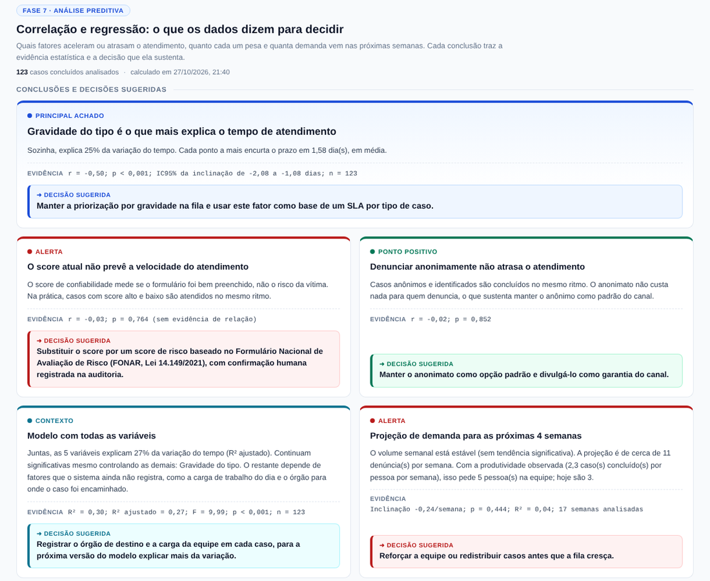
</div>

</details>

<br>

<a id="parte-4"></a>

##  Parte 4: blockchain

> **Quem guarda a trilha não pode ser quem atesta que ela está completa.**

O contrato [`AncoraProtege.sol`](blockchain/contracts/AncoraProtege.sol) guarda, fora do servidor, a impressão digital da trilha de auditoria e das evidências. Ele só acrescenta e nunca volta atrás: um servidor restaurado de um backup antigo não consegue "reancorar" o passado.

<picture>
  <source media="(prefers-color-scheme: dark)" srcset="docs/readme/ancoragem-dark.svg">
  
</picture>

- **Nada pessoal vai para a cadeia.** Só hashes e contadores. Cada foto entra como `sha256(hash do arquivo + sal)`: sem o sal, quem tem uma cópia da foto não descobre que ela virou prova.
- **Papéis separados.** O gestor autoriza e contesta; a rotina de ancoragem só acrescenta; qualquer pessoa confere de graça.
- **21 testes**, 100% das linhas cobertas, incluindo privacidade, restauração de backup e chave de servidor comprometida.

> [!NOTE]
> **Exercício C** ([resultado](blockchain/resultados/demonstracao-20261027.txt)): depois de restaurar um backup, a verificação interna diz "cadeia intacta" e a blockchain diz **"o registro 13 NÃO EXISTE MAIS"**. A mesma foto com **um pixel** trocado é recusada como prova.

Rede indicada para produção: a **Rede Blockchain Brasil** (BNDES e TCU, Hyperledger Besu). Como rodar: [`blockchain/README.md`](blockchain/README.md).

<br>

<a id="funcionalidades"></a>

##  Funcionalidades

<table>
<tr>
<td width="50%" valign="top">

#### Lado do cidadão

Denunciar sem se expor.

- Três níveis de anonimato, do total ao identificado
- Protocolo imprevisível para acompanhar, sem login
- Evidência em arquivo (sem GPS escondido) ou relato em áudio
- Fluxo de emergência com geolocalização
- **Botão de pânico físico**, sem tela e sem formulário
- **Totem público**, para quem não tem aparelho
- Saída rápida (SHIFT 3 vezes), **Modo Seguro**, PT/EN e VLibras

</td>
<td width="50%" valign="top">

#### Lado do órgão

Decidir com informação.

- Quatro perfis com permissões distintas, decididas no servidor
- Kanban, fila de priorização e ações reversíveis
- **Estatística que sugere decisões**, com p-valor e intervalo de confiança
- Mapa por município com k-anonimato
- Dispositivos de campo e focos de reincidência
- Trilha de auditoria **ancorada em blockchain** e backups verificados
- **VigIA**, que lê o acervo e recomenda ação

</td>
</tr>
</table>

<details>
<summary><b>Dispositivos de campo</b> &nbsp;·&nbsp; IoT, da Fase 6</summary>
<br>

Três aparelhos, três regras distintas, **uma tabela só**. A decisão de usar um discriminador de origem em vez de três tabelas paralelas segue o padrão *Single Table Inheritance* (FOWLER, 2002): a pergunta do gestor, "o que chegou de campo hoje?", atravessa as três origens, e uma quarta origem amanhã é uma linha, não uma migração de esquema.

| Origem | Regra | Por quê |
|---|---|---|
| 🆘 **Botão de pânico** | Repique de **120 s** por aparelho | Dois toques dentro da janela são o mesmo pedido, não dois casos. A borda não é repique: 120 s exatos abrem caso novo |
| 📍 **Tornozeleira** | Perímetro do servidor, **600 s** entre alertas | O aparelho envia posição e só. A resposta **não devolve distância nem raio**, porque isso entregaria um mapa do perímetro a quem está sendo monitorado |
| 🏛️ **Totem público** | Repique de **20 s**, relato de **15 a 1200** caracteres | Premissa invertida: numa fila, duas pessoas seguidas são duas pessoas. O totem nunca informa a própria posição, ela vem do cadastro |

A distância é calculada por **Haversine** sobre o raio médio da Terra, e não por Pitágoras: em latitudes brasileiras o erro do plano cartesiano é grande o bastante para decidir errado perto da borda do perímetro.

**Nenhum aparelho envia urgência, classificação ou veredito.** Ele envia fato bruto. Quem classifica é o servidor, e quem lê o texto é o VigIA, exatamente como faz com uma denúncia digitada. Evento aceito que **não** gera caso, como telemetria fora do perímetro, é registrado do mesmo jeito: sem o silêncio gravado não há como provar depois que o equipamento estava reportando.

> [!NOTE]
> O [`simulador-iot.html`](simulador-iot.html) é um **instrumento de teste**, e a própria página diz isso no cabeçalho. Ele ocupa o lugar do aparelho físico que a entrega não tem, e não faz parte do produto.

</details>

<details>
<summary><b>Focos de reincidência</b> &nbsp;·&nbsp; estruturas de dados, da Fase 6</summary>
<br>

Um `GROUP BY` responde quantas denúncias um município teve. Ele **não** responde se elas formam uma cadeia. Agrupar por chave junta janeiro com dezembro no mesmo balde; agrupar por mês corta a cadeia que atravessa a virada do mês. O vínculo é relacional, não categórico, e por isso é um problema de grafo.

**A regra do elo:** duas denúncias entram na mesma cadeia quando são do mesmo tipo, do mesmo município e estão a no máximo **14 dias** uma da outra. A cadeia só conta a partir de **3** denúncias.

| Etapa | Estrutura | Complexidade |
|---|---|:--:|
| Indexar por data | `TreeMap`, árvore rubro-negra | O(n log n) |
| Recortar a janela | `subMap` | O(log n + k) |
| Ordenar a janela | *merge sort* estável | O(k log k) |
| Localizar o bloco de um grupo | busca binária, *lower bound* | O(log k) |
| Montar o grafo | só pares consecutivos | O(k) |
| Componentes conexos | BFS com `ArrayDeque` | O(V + E) = O(k) |
| **Total por consulta** | | **O(k log k)** |

O detalhe que muda o custo está na montagem do grafo: dentro de um grupo já ordenado por data, **ligar só os vizinhos basta**. Se A liga com B e B liga com C, os três já estão no mesmo componente. Isso reduz as arestas de até `k(k-1)/2` para no máximo `k-1`. Para `k = 160`, a janela de 90 dias da base atual, é a diferença entre cerca de 12,7 mil comparações e 159.

A busca em largura é **iterativa, e não recursiva**: uma cadeia de 10 mil denúncias encadeadas derrubaria a pilha de chamadas.

**O achado: foco não é o mesmo que volume.**

A tela ficou pronta e mostrou um agrupamento de **49 denúncias** de violência em Barueri no topo da lista. O algoritmo estava certo, elas formam mesmo uma cadeia. Só que aquilo não era um surto: era **tudo que o município produz naquele tipo**. Um foco pede operação pontual; demanda constante pede equipe permanente. São respostas diferentes, e a tela estava chamando as duas de foco.

A correção foi nomear o que o algoritmo encontrou: cobertura de **70% ou mais** do grupo **e** grupo com pelo menos **10** denúncias passam a ser marcados como **fluxo contínuo**. Sobre a base atual, são **7 focos e 2 fluxos contínuos**, e o maior foco caiu de 49 para 7.

</details>

<br>

<a id="como-executar"></a>

##  Como executar

O caminho completo, do zero até as provas:

<picture>
  <source media="(prefers-color-scheme: dark)" srcset="docs/readme/estrada-dark.svg">
  
</picture>

Você precisa apenas de um **JDK 17 ou superior** (testado também com o 21). O Maven é baixado automaticamente na primeira execução.

> [!TIP]
> Use **janelas de terminal separadas** para a API e para o servidor de arquivos. Se as duas forem a mesma janela, o segundo comando derruba o primeiro.

### 1. Backend (API Java)

```powershell
cd backend
.\build.cmd clean test     # Windows: roda os 217 testes
.\build.cmd run            # sobe a API em http://localhost:8080
```

No Linux ou macOS, use o Maven direto: `mvn clean test` e `mvn spring-boot:run`.

<details>
<summary>Gerar o executável</summary>

```powershell
.\build.cmd clean package -DskipTests
java -jar target\protege-backend-1.0.0.jar
```

</details>

**Modo demonstração (padrão).** Sobe sem configurar nada. Os segredos (JWT e chave dos aparelhos) são **sorteados a cada execução**, a chave dos aparelhos é gravada em `backend/data/iot-chave.txt` para colar no simulador, e a API escuta só em `127.0.0.1`. O banco é o **H2 embutido**, criado em `backend/data/` com a carga de demonstração.

> [!WARNING]
> Se você já tinha executado uma versão anterior, apague `backend/data/` antes de subir: o H2 não recarrega a carga de demonstração sobre um banco que já existe.

**Modo produção** (`PROTEGE_DEMO=false`). A API **se recusa a subir** sem `JWT_SECRET`, `ADMIN_SENHA` e `PROTEGE_IOT_CHAVE` fortes, não cria contas nem casos de demonstração, apaga contas de demonstração herdadas e desliga o Swagger e o console do H2.

| Variável | Para quê |
|---|---|
| `PROTEGE_DEMO` | `true` (padrão) ou `false` |
| `JWT_SECRET`, `ADMIN_SENHA`, `PROTEGE_IOT_CHAVE` | Segredos de produção |
| `GEMINI_API_KEY` | Liga o Gemini no VigIA (opcional; sem ela, valem as regras) |
| `PROTEGE_PROXY_CONFIAVEL`, `CORS_ORIGENS` | Rodar atrás do proxy de [`infra/`](infra/README.md) |
| `BACKUP_DIR`, `BACKUP_RETENCAO`, `BACKUP_CRON` | Backup (padrão: `./data/backups`, 7 cópias, diário às 02:30) |
| `H2_CONSOLE` | `true` liga o console do banco, só na máquina local |

| Recurso | Endereço |
|---|---|
| 📘 Documentação da API (modo demonstração) | <http://localhost:8080/swagger-ui.html> |
| 🗄️ Console do banco (com `H2_CONSOLE=true`) | <http://localhost:8080/h2-console> · JDBC `jdbc:h2:file:./data/protege` · usuário `sa` |

### 2. Front-end (portal, painel e simulador)

Sirva por HTTP. Abrir o `index.html` com duplo clique faz o navegador bloquear as chamadas por CORS.

```powershell
py -m http.server 5500
```

| Tela | Endereço |
|---|---|
| Portal e painel | <http://localhost:5500/index.html> |
| Formulário em React | <http://localhost:5500/formulario-react.html> |
| Simulador de dispositivos | <http://localhost:5500/simulador-iot.html> |

> [!IMPORTANT]
> **A porta importa.** A API aceita apenas `5500`, `5501`, `3000` e `8080` em `localhost` (ou o que estiver em `CORS_ORIGENS`).

A **etiqueta de conexão** no alto da barra lateral mostra `API conectada` ou `modo local`. Com a API no ar, o painel nunca mostra dados locais no lugar de uma recusa: um 401 ou 403 aparece como aviso de acesso.

### 3. Backup e restauração

O backup diário é automático. Como ADMIN, também dá para gerar um na aba **Auditoria** (card *Backups do banco*), que lista cada cópia com o hash conferido. Para restaurar, **com a API parada**:

```powershell
cd backend
.\restaurar-backup.cmd data\backups\protege-AAAAMMDD-HHMMSS-mmm.zip
```

O roteiro confere o SHA-256 contra o manifesto antes de restaurar e devolve o banco original se algo falhar.

### 4. Os roteiros de prova

| O que | Onde | Como |
|---|---|---|
| 11 ataques contra a API | [`seguranca/`](seguranca/README.md) | `py seguranca\simular_ataques.py`, com a API no ar |
| Borda de rede (39 verificações) | [`infra/`](infra/README.md) | `bash infra/testar-rede.sh` (Linux ou WSL, com nginx) |
| Contrato e ancoragem | [`blockchain/`](blockchain/README.md) | `npm install`, `npm test`; `npm run no` e depois `implantar`, `ancorar`, `verificar` |

<br>

<a id="usuarios"></a>

##  Usuários de demonstração

Criados automaticamente **só no modo demonstração**. Existem quatro para que a **segregação de acesso possa ser verificada**, e não apenas descrita.

| | E-mail | Senha | Perfil | Vê identificação | Vê auditoria |
|:---:|---|---|---|:---:|:---:|
| 🔑 | `admin@protege.gov.br` | `admin123` | ADMIN | ✅ | ✅ |
| 🏛️ | `gestor@protege.gov.br` | `gestor123` | GESTOR | ✅ | ❌ |
| 👁️ | `atendente@protege.gov.br` | `atendente123` | ATENDENTE | ❌ | ❌ |
| 🔎 | `auditor@protege.gov.br` | `auditor123` | AUDITOR | ❌ | ✅ |
| 💻 | `offline@protege.gov.br` | `offline123` | demonstração **sem servidor** | local | local |

O gestor **não** consulta a trilha de auditoria (quem opera não fiscaliza o próprio uso), e o auditor **não** lê relatos (quem fiscaliza não opera). Logado como ADMIN, o painel troca de perfil sem senha: o pedido vai ao servidor e fica na trilha.

<br>

<a id="visao-tecnica"></a>

##  Visão técnica

<details>
<summary><b>Arquitetura</b> &nbsp;·&nbsp; cada camada e por quê</summary>
<br>

| Camada | Tecnologia | Por quê |
|---|---|---|
| Front-end | HTML, CSS e JavaScript, React via CDN no formulário, Chart.js, Leaflet | Leve, sem build. Integra IBGE (estados e cidades) e OpenStreetMap |
| Back-end | **Java 17 + Spring Boot 3.3.4** | Padrão de mercado para APIs corporativas e governamentais |
| Banco | **H2** (demonstração), **PostgreSQL** (produção), modelo físico em **Oracle** | Roda ao ser descompactado; scripts em `database/` |
| Borda de rede | **nginx** com TLS 1.2/1.3 e TLS mútuo | Único ponto exposto à internet; [`infra/`](infra/README.md) |
| Dispositivos | REST com chave por aparelho e, na borda, certificado por aparelho | Sem broker MQTT: três origens de baixa frequência não justificam a infraestrutura |
| Segurança | Spring Security, JWT, BCrypt, RBAC, guardião de segredos | Perfis relidos do banco a cada requisição; limites por origem real |
| Auditoria | Trilha encadeada por SHA-256 e **ancorada em blockchain** | Alteração no meio é detectada pela cadeia; corte no fim, pela blockchain |
| Blockchain | **Solidity 0.8.28**, OpenZeppelin, Hardhat | Contrato só acrescenta; nada pessoal na cadeia |
| IA | Google Gemini com plano B por regras | O relato não sai por padrão; a IA só sobe a urgência, nunca baixa |
| Documentação | Swagger / OpenAPI 3 | O botão *Authorize* executa as rotas protegidas pelo navegador |

</details>

<details>
<summary><b>Endpoints</b> &nbsp;·&nbsp; 44 rotas, 18 auditadas</summary>
<br>

São **44 mapeamentos**. **18** deles estão anotados com `@Auditavel` e alimentam a trilha, inclusive as tentativas recusadas.
🔒 indica que a rota exige o cabeçalho `Authorization: Bearer <token>`.

<details open>
<summary><b>Novos nesta fase</b></summary>

| Método | Rota | Perfil | Descrição |
|---|---|---|---|
| `GET` | `/api/stats/regressao` | 🔒 todos | Correlação, regressão simples e múltipla, tendência, equipe necessária e conclusões |
| `GET` | `/api/backup` | ADMIN, AUDITOR | Backups com o hash registrado e a situação (íntegro ou alterado) |
| `POST` | `/api/backup` | ADMIN | Backup manual. **409** se o último tem menos de 10 minutos |
| `POST` | `/api/auth/demo/perfil` | ADMIN, só em demonstração | Troca de perfil sem senha no cliente. **Auditada** |
| `GET` | `/api/auditoria/ancoragem/estado` | AUDITOR, ADMIN | Hash do último registro, total e hashes das evidências novas, para a blockchain. **Auditada** |
| `GET` | `/api/auditoria/ancoragem/registro/{id}` | AUDITOR, ADMIN | Hash atual de um registro já ancorado |

</details>

<details>
<summary><b>Dispositivos de campo</b></summary>

| Método | Rota | Acesso | Descrição |
|---|---|---|---|
| `POST` | `/api/iot/acionamento` | `X-Device-Key` | Botão de pânico. **201** com o protocolo. Acionamento repetido dentro de 120 s é tratado como repique e vinculado ao mesmo caso |
| `POST` | `/api/iot/telemetria` | `X-Device-Key` | Posição da tornozeleira. **202**, com ou sem violação. A resposta **não** informa distância, raio nem centro do perímetro |
| `POST` | `/api/iot/totem` | `X-Device-Key` | Registro em totem. **201** aceito · **200** repique · **422** recusado, com o código do motivo |
| `GET` | `/api/iot/eventos` | 🔒 | Eventos do barramento, com a decisão do servidor em cada linha. **Leitura auditada** |
| `GET` | `/api/iot/resumo` | 🔒 | Contadores por origem |
| `GET` | `/api/reincidencia/focos` | 🔒 | Agrupamentos da janela, já classificados em foco ou fluxo contínuo. **Leitura auditada** |
| `GET` | `/api/reincidencia/parametros` | 🔒 | Os limiares em vigor |

A chave do aparelho é conferida **antes** de ler o corpo e comparada em tempo constante. Atrás da borda de rede, cada aparelho também precisa de **certificado próprio** (TLS mútuo, [`infra/`](infra/README.md)): sem ele, a requisição para no proxy.

</details>

<details>
<summary><b>Canal do cidadão, público</b></summary>

| Método | Rota | Descrição |
|---|---|---|
| `POST` | `/api/denuncias` | Registra denúncia. Devolve `201` com `Location`, protocolo, score e análise da IA |
| `GET` | `/api/denuncias/protocolo/{protocolo}` | Consulta o andamento. Não expõe relato nem endereço |
| `GET` | `/api/vigia/status` | Informa se a IA está em modo Gemini ou Regras |
| `POST` | `/api/auth/login` | Autentica o servidor e devolve o token JWT |

</details>

<details>
<summary><b>Painel do órgão</b></summary>

| Método | Rota | Perfil | Descrição |
|---|---|---|---|
| `GET` | `/api/denuncias` | 🔒 | Lista paginada com filtros de status, tipo e UF. **Sem relato e sem endereço** |
| `GET` | `/api/denuncias/{id}` | 🔒 | Detalhe do caso. Consulta sensível: gera auditoria |
| `PUT` | `/api/denuncias/{id}` | 🔒 | Atualiza os dados descritivos |
| `PATCH` | `/api/denuncias/{id}/status` | 🔒 | Muda o status e registra na linha do tempo |
| `PATCH` | `/api/denuncias/{id}/responsavel` | 🔒 | Atribui responsável |
| `DELETE` | `/api/denuncias/{id}?motivo=` | GESTOR, ADMIN | Exclusão lógica com anonimização. Exige motivo |
| `GET` | `/api/equipe` | 🔒 | Lista os membros que podem ser responsabilizados por um caso |
| `GET` | `/api/equipe/{id}` | 🔒 | Detalhe de um membro |
| `POST` | `/api/equipe` | GESTOR, ADMIN | Cadastra membro. `201` com `Location` |
| `PUT` | `/api/equipe/{id}` | GESTOR, ADMIN | Atualiza membro |
| `DELETE` | `/api/equipe/{id}` | GESTOR, ADMIN | Remove membro |
| `GET` | `/api/stats` | 🔒 | Totais por status, tipo, urgência e UF |
| `GET` | `/api/stats/analitico` | 🔒 | Relatório estatístico completo: medidas de posição e dispersão, quartis, outliers, assimetria, correlação e recortes por tipo, urgência e anonimato |

</details>

<details>
<summary><b>Evidências e exportação</b></summary>

| Método | Rota | Perfil | Descrição |
|---|---|---|---|
| `POST` | `/api/denuncias/protocolo/{p}/evidencias` | público | Anexa arquivo (`multipart`). **201** · **413** acima de 5 MB · **415** formato recusado · **429** limite por origem |
| `GET` | `/api/denuncias/{id}/evidencias` | 🔒 | Metadados dos anexos. Nunca o binário |
| `GET` | `/api/evidencias/{id}/arquivo` | 🔒 | Baixa o arquivo. **Consulta sensível: gera auditoria** |
| `DELETE` | `/api/evidencias/{id}?motivo=` | GESTOR, ADMIN | Remove o binário, mantém o registro. **204** |
| `GET` | `/api/exportacao/denuncias` | GESTOR, ADMIN | CSV auditado, sem o relato, com o mascaramento do perfil |

**O tipo de um arquivo enviado é determinado pela assinatura do conteúdo**, e não pela extensão nem pelo cabeçalho `Content-Type`, que são escolhidos por quem envia. Um executável renomeado para `foto.jpg` é recusado com 415. O nome informado pelo usuário nunca chega ao disco: o arquivo recebe um UUID sem extensão, fora da pasta servida pelo servidor web.

`/api/stats/analitico` deliberadamente **não** gera registro de auditoria: a resposta é integralmente agregada, nenhum campo permite chegar a um caso individual, e auditar leitura de agregado só encheria a trilha de ruído.

</details>

<details>
<summary><b>Fluxo de atendimento, estruturas de dados</b></summary>

| Método | Rota | Estrutura | Descrição |
|---|---|---|---|
| `GET` | `/api/fluxo/fila` | `PriorityQueue` | Ordem de atendimento: urgência ➜ score ➜ antiguidade |
| `POST` | `/api/fluxo/fila/atender` | heap, `poll` O(log n) | Assume o caso do topo |
| `GET` | `/api/fluxo/pilha` | `ArrayDeque` LIFO | Histórico reversível do servidor |
| `POST` | `/api/fluxo/desfazer` | pilha, `pop` O(1) | Restaura o status anterior sem reescrever o histórico |

</details>

<details>
<summary><b>Auditoria e VigIA</b></summary>

| Método | Rota | Perfil | Descrição |
|---|---|---|---|
| `GET` | `/api/auditoria` | AUDITOR, ADMIN | Trilha paginada, com filtros de período, usuário e ação |
| `GET` | `/api/auditoria/integridade` | AUDITOR, ADMIN | Recalcula a cadeia de hashes e aponta onde foi rompida |
| `GET` | `/api/auditoria/acoes` | AUDITOR, ADMIN | Catálogo das operações auditadas |
| `POST` | `/api/vigia/analisar/{id}` | 🔒 | Reanalisa a urgência de um caso |
| `POST` | `/api/vigia/perguntar` | 🔒 | Pergunta livre do gestor. O contexto enviado à IA não contém relatos |

</details>

</details>

<details>
<summary><b>Banco de dados</b> &nbsp;·&nbsp; modelo físico Oracle e consultas</summary>
<br>

A pasta `database/` traz o modelo físico completo em Oracle, com **15 tabelas**, as restrições de cada fase e as consultas analíticas.

| Arquivo | Conteúdo |
|---|---|
| `01_ddl_oracle.sql` | Modelo das fases anteriores: 12 tabelas, 30 CHECK, 13 índices |
| `02_dml_carga.sql` | Domínios, equipe, servidores e denúncias geradas deterministicamente |
| `03_consultas.sql` | Consultas analíticas do relatório e de auditoria |
| `04_ddl_fase6.sql` | 3 tabelas da Fase 6: `evento_iot`, `zona_exclusao` e `ponto_totem` |
| `05_consultas_fase6.sql` | 6 consultas com `ROLLUP`, `GROUPING`, `RANK`, `SUM OVER`, `LAG` e subconsulta correlacionada |
| `06_ddl_fase7.sql` | Restrições da Fase 7: formato do protocolo novo e as ações `BACKUP` e `TROCA_PERFIL_DEMO` |
| `07_estatistica_fase7.sql` | **Correlação e regressão no banco**: `CORR`, `CORR_S`, `REGR_*`, `PERCENTILE_CONT`, tendência semanal e equipe |
| `05_resultados_fase6.txt`, `07_resultados_fase7.txt` | Resultados conferidos sobre a base de demonstração |
| `gerar_carga_fase6.py` | Gerador determinístico da carga (`random.seed(561601)`) |

</details>

<details>
<summary><b>Testes</b> &nbsp;·&nbsp; 217 Java e 21 do contrato</summary>
<br>

```powershell
cd backend
.\build.cmd clean test
```

Cobrem as regras de negócio das fases anteriores (score, VigIA, fila, pilha, estatística descritiva, IoT, focos de reincidência) e, desta fase: os segredos obrigatórios em produção, o limite por origem real, a máquina de estados do caso, a imutabilidade do relato, a remoção de metadados, a privacidade do VigIA, o backup verificado, o IP real atrás do proxy, a estatística inferencial (conferida contra o quarteto de Anscombe) e o estado da trilha para a ancoragem.

Os valores esperados nos testes de estatística foram **calculados fora do programa**. Um teste que confere o programa contra a saída do próprio programa passa a fingir que a conta está certa exatamente quando ela deixa de estar.

Além dos testes unitários, três roteiros testam o sistema rodando: [`seguranca/simular_ataques.py`](seguranca/simular_ataques.py), [`infra/testar-rede.sh`](infra/testar-rede.sh) e a demonstração em [`blockchain/`](blockchain/README.md).

</details>

<details>
<summary><b>Estrutura do projeto</b> &nbsp;·&nbsp; onde fica cada coisa</summary>
<br>

```
.
├── index.html                  portal do cidadão e painel do servidor
├── formulario-react.html       mesmo formulário em React 18 (CDN, sem build)
├── simulador-iot.html          instrumento de teste dos três dispositivos
├── search.html                 tela-disfarce do Modo Seguro
├── css/                        folhas de estilo (regressao.css é desta fase)
├── js/                         30 módulos; storage-guard.js traz o escape contra XSS
├── docs/                       documento, relatório, roteiro e imagens desta entrega
├── wireframes/ · diagramas/    telas e modelos das fases anteriores
├── database/                   modelo físico Oracle e consultas (06 e 07 são desta fase)
├── seguranca/                  simulação de ataques, exercícios e resultados   ← Parte 1
├── infra/                      borda nginx, autoridade certificadora e teste    ← Parte 2
├── blockchain/                 contrato, testes, rotinas e resultados          ← Parte 4
└── backend/
    ├── build.cmd / build.ps1   bootstrap: baixa o Maven se necessário
    ├── restaurar-backup.cmd    restauração com conferência de hash
    └── src/
        ├── main/java/br/gov/protege/      93 classes
        │   ├── config/       guardião de segredos, OpenAPI
        │   ├── controller/   13 controladores, 44 rotas
        │   ├── security/     JWT, RBAC, CORS, limites, chave de dispositivo
        │   ├── service/      ... BackupService, FluxoStatus, AnalisePreditivaService
        │   └── util/         Inferencia (estatística), mascaramento, metadados, LogSeguro
        └── test/java/...     29 classes, 217 testes JUnit
```

</details>

<details>
<summary><b>Quero mudar X, onde vou?</b></summary>
<br>

| Quero... | Vá em |
| :--- | :--- |
| Mudar o que cada perfil pode fazer | `security/SecurityConfig.java` ➜ matriz de rotas por perfil |
| Mudar os limites por minuto (denúncia 5, login 20, consulta 30) | `security/RateLimitFilter.java` ➜ constantes `LIMITE_*` |
| Mudar os caminhos do status de um caso | `service/FluxoStatus.java` |
| Mudar a ordem da fila de atendimento | `service/FilaAtendimentoService.java` |
| Mudar as regras de urgência do VigIA | `service/VigiaService.java` |
| Mudar a análise estatística e as conclusões | `service/AnalisePreditivaService.java` (cálculo em `util/Inferencia.java`) |
| Mudar a regra dos focos (14 dias, mínimo de 3) | `service/ReincidenciaService.java` ➜ `JANELA_ELO_DIAS`, `MINIMO_PARA_FOCO` |
| Mudar horário, pasta ou retenção do backup | `application.properties` ➜ `protege.backup.*` (ou `BACKUP_CRON`, `BACKUP_DIR`, `BACKUP_RETENCAO`) |
| Mudar a borda de rede (TLS, limites, CSP) | `infra/nginx/protege.conf` |
| Mudar o contrato de ancoragem | `blockchain/contracts/AncoraProtege.sol` (e os 21 testes em `blockchain/test/`) |
| Traduzir ou mudar textos do site (PT/EN) | `js/i18n.js` |

Os caminhos Java são relativos a `backend/src/main/java/br/gov/protege/`.

</details>

<details>
<summary><b>Pontos de atenção</b> &nbsp;·&nbsp; o que ainda não está resolvido</summary>
<br>

- **Sem segundo fator para servidores.** O caminho previsto é o login gov.br (OpenID Connect), que já traz o segundo fator.
- **A "cifra" do armazenamento do navegador é ofuscação.** `js/lgpd.js` usa XOR com a chave no próprio cliente: impede leitura casual, não perícia. A troca por AES-GCM da Web Crypto está nos próximos passos.
- **Banco e evidências ficam em claro no disco do servidor.** Em produção, a política é volume cifrado.
- **A política de conteúdo (CSP) ainda aceita `unsafe-inline`**, porque o painel usa `onclick` no HTML.
- **A topologia de produção não foi montada fisicamente.** A borda foi testada numa máquina só; segmentação, VPN, réplica e mitigação de DDoS estão descritas, não montadas.
- **A blockchain da demonstração é local.** A adesão à Rede Blockchain Brasil é um passo institucional.
- **Os dados são sintéticos** (semente 561601). Mostram o método, não a realidade de um órgão.
- **Nenhuma usuária real testou o sistema.** É o primeiro item dos próximos passos.

</details>

<br>

<a id="documentacao"></a>

##  Documentação da entrega

| Arquivo | O que é |
|---|---|
| [`docs/Protege_Mais_Visao_de_Futuro_Documento.pdf`](docs/Protege_Mais_Visao_de_Futuro_Documento.pdf) | **Documento técnico da Atividade Visão de Futuro**: segurança, redes, estatística e blockchain ([.docx](docs/Protege_Mais_Visao_de_Futuro_Documento.docx)) |
| [`docs/Protege_Mais_EC_Atividade5_Relatorio_Final.pdf`](docs/Protege_Mais_EC_Atividade5_Relatorio_Final.pdf) | **Relatório Final do Enterprise Challenge EGESP**: conceito, metodologia, custos e viabilidade ([.docx](docs/Protege_Mais_EC_Atividade5_Relatorio_Final.docx)) |
| [`docs/Protege_Mais_Visao_de_Futuro_Roteiro.md`](docs/Protege_Mais_Visao_de_Futuro_Roteiro.md) | Conteúdo dos slides e roteiro do vídeo |
| [`seguranca/`](seguranca/README.md), [`infra/`](infra/README.md), [`blockchain/`](blockchain/README.md) | Cada parte com o próprio README e os resultados gravados |

Os documentos das entregas anteriores ficam no repositório daquelas fases ([Fase 6](https://github.com/Gabriell230G/ProtegeMais-Fase-6)).

O que ainda **não** está resolvido está declarado no fim de cada Parte do documento técnico: segundo fator de autenticação, cifra de verdade no armazenamento do navegador, montagem física da topologia de produção, adesão à Rede Blockchain Brasil e, principalmente, avaliação com usuárias reais.

<br>

<a id="roadmap"></a>

##  Roadmap do projeto

<picture>
  <source media="(prefers-color-scheme: dark)" srcset="docs/readme/linha-tempo-dark.svg">
  
</picture>

<details>
<summary><b>Histórico de entregas</b></summary>
<br>

| Data | Entrega | Principal avanço |
| :--- | :--- | :--- |
| 16/03 | HackGov Fase 1 | Conceito, site navegável, primeiras telas |
| 29/03 | HackGov Fase 2 | Backlog com critérios de aceitação, UML, primeiro código Java |
| 16/04 | Enterprise Challenge, Atividade 1 | Proposta de dados e IA para ir além da digitalização |
| 13/05 | HackGov Fase 3 | Modelo de dados (normalização, Oracle) e visual próximo do gov.br |
| 18/05 | Enterprise Challenge, Atividade 2 | 1ª mentoria EGESP; score, painel analítico e anonimato total |
| 21/05 | HackGov Fase 4 | Funções do navegador: GPS, áudio, QR Code, React |
| 13/09 | HackGov Fase 5 e EC, Atividade 4 | API Java com Spring Boot, perfis, trilha de auditoria, VigIA com Gemini |
| 14/09 | HackGov Fase 6 | Dispositivos de campo (IoT), SQL avançado, focos de reincidência |
| **03/11** | **Visão de Futuro e EC, Atividade 5** | **26 falhas corrigidas, ataques simulados, rede, correlação e regressão, blockchain** |

</details>

<br>

<p align="center">
  
  <br><br>
  <b>Gabriel Vasconcellos Gomes</b> · RM 561601 · 2SIOA · Barueri, SP
  <br>
  <a href="https://www.linkedin.com/in/gabriel-vasconcellos-gomes-76a246246/">LinkedIn</a> · <a href="https://github.com/Gabriell230G">GitHub</a>
  <br><br>
  <sub>Projeto acadêmico do HackGov e do Enterprise Challenge FIAP, em parceria com a EGESP · 2026</sub>
</p>

<p align="center"><b>Primeiro o ataque, depois o texto.</b></p>
