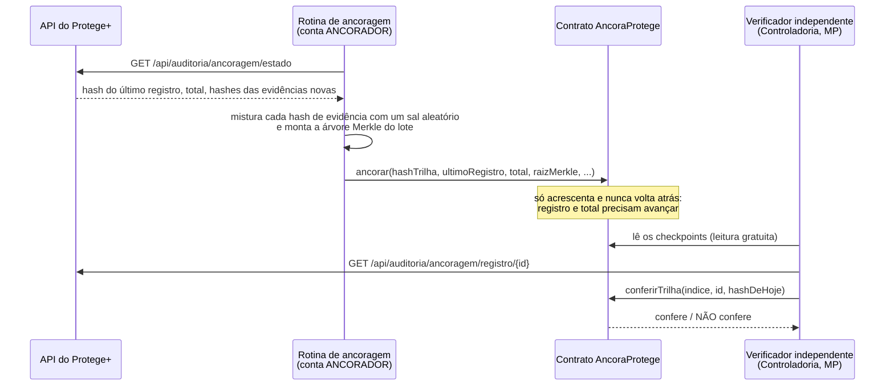

# Blockchain: a testemunha externa da trilha e das evidências

Parte 4 da Atividade Visão de Futuro: *Blockchain e protótipo de Smart Contract em Solidity*.

## O problema que motivou

A trilha de auditoria do Protege+ é encadeada por SHA-256. Cada registro carrega o hash do anterior, então alterar ou apagar um registro **do meio** quebra a cadeia, e a verificação aponta onde.

O exercício B da Parte 1 ([`seguranca/`](../seguranca/README.md)) mostrou o limite disso. Restaurar um backup antigo **corta o fim** da trilha, e o que sobra continua coerente consigo mesmo. A verificação interna diz "cadeia intacta" e os últimos registros somem sem deixar marca.

Quem guarda a cadeia não pode ser quem atesta que ela está completa. Este contrato é a testemunha que fica fora do servidor.

## Como funciona



**O que vai para a blockchain:**
- o hash do último registro da trilha, que resume todos os anteriores;
- contadores;
- a raiz Merkle de um lote de evidências.

**O que nunca vai:** nome, protocolo, relato, endereço, e-mail, IP, nem o hash puro de um arquivo.

Cada evidência entra como `sha256(hashDoArquivo ‖ sal)`, com um sal aleatório de 32 bytes que fica só com o órgão. Sem o sal, alguém que tenha uma cópia da foto (o próprio agressor, por exemplo) não consegue descobrir que ela foi entregue como prova. Um teste do contrato confere isso.

O cuidado é obrigatório porque um registro em blockchain não se apaga, e a LGPD manda eliminar dados pessoais quando a finalidade acaba.

### Papéis

| Conta | Pode | Não pode |
|---|---|---|
| **Gestor** (órgão) | Autorizar e revogar ancoradores, contestar uma ancoragem | Ancorar |
| **Ancorador** (rotina automática) | Acrescentar checkpoints | Alterar ou apagar qualquer checkpoint, contestar |
| **Qualquer pessoa** | Ler e conferir, sem custo | Escrever |

Se a chave do servidor vazar, o gestor revoga o ancorador na hora. Uma ancoragem forjada com essa chave pode ser **contestada**: ela fica visível para sempre, mas deixa de provar qualquer coisa e deixa de travar as próximas.

## Resultado registrado (27/10/2026)

O log completo está em [`resultados/demonstracao-20261027.txt`](resultados/demonstracao-20261027.txt).

| Etapa | O que aconteceu |
|---|---|
| 1. Ancorar | Checkpoint com a trilha e um lote de 2 evidências: 162 mil de gas |
| 2. Provar evidência | A foto baixada do sistema é reconhecida como evidência #1 e o contrato confere a prova Merkle. A mesma foto com **um pixel** trocado é recusada. |
| 3. Exercício C | Backup gerado e, depois dele, uma atendente abre 3 casos. Ancoragem feita, banco perdido, backup restaurado. A verificação interna diz **"cadeia intacta"**, mas a verificação contra a blockchain diz **"o registro 13 NÃO EXISTE MAIS"**, e a rotina se recusa a ancorar a trilha cortada. |

**Testes do contrato:** 21 passando, cobertura de 100% das linhas e 90,9% dos desvios (`npx hardhat coverage`).

Ancorar 100 evidências custa o mesmo que ancorar uma: só a raiz vai para a cadeia, e a prova de uma evidência tem no máximo 7 hashes.

## Como rodar no Windows

Pré-requisito: Node.js 18 ou mais novo (`winget install OpenJS.NodeJS.LTS`).

```powershell
cd blockchain
npm install
npm test
```

O compilador Solidity vem do pacote npm `solc`, sem download extra, então o projeto compila também em rede corporativa.

### Demonstração completa (três terminais)

```powershell
# Terminal 1: blockchain local (deixe aberto)
cd blockchain
npm run no

# Terminal 2: a API (deixe aberto)
cd backend
.\build.cmd run

# Terminal 3
cd blockchain
npm run implantar        # implanta o contrato
npm run ancorar          # ancora a trilha e as evidências novas
npm run verificar        # confere a trilha de hoje contra tudo o que foi ancorado

$env:ARQUIVO="C:\caminho\foto.jpg"; npm run provar        # prova uma evidência
$env:EVIDENCIA_ID="2"; npm run provar                     # e confere se é a #2
```

A rotina usa a conta de **auditor** da demonstração, porque só precisa ler. Em produção, informe `PROTEGE_EMAIL` e `PROTEGE_SENHA` (e `PROTEGE_API` se a API não estiver em `127.0.0.1:8080`).

Para provar uma evidência, use o arquivo baixado do sistema. A API remove os metadados (EXIF) na entrada, e o hash ancorado é o do arquivo já limpo.

### Exercício C no seu computador

1. Com tudo rodando, entre como ADMIN e gere um backup na aba Auditoria (card "Backups do banco").
2. Faça qualquer coisa que gere trilha (abra alguns casos) e rode `npm run ancorar`.
3. Pare a API (Ctrl+C no Terminal 2) e restaure o backup, na pasta backend:
   `.\restaurar-backup.cmd data\backups\protege-AAAAMMDD-HHMMSS-mmm.zip` (o nome do arquivo que você gerou).
4. Suba a API de novo e rode `npm run verificar`: o alerta aparece.

O nó local esquece tudo quando é fechado. Se reiniciar o Terminal 1, rode `npm run implantar` de novo: os registros do contrato anterior são guardados numa subpasta de `ancoragens\localhost`.

## Onde rodaria de verdade

| Opção | Custo por ancoragem | Prós | Contras |
|---|---|---|---|
| **Rede Blockchain Brasil (RBB)**, criada em 2022 por BNDES e TCU, baseada em Hyperledger Besu | Sem taxa de mercado | Feita para o setor público, compatível com este contrato sem mudar uma linha, com entrada de participantes aprovada pela governança | Depende da adesão do órgão |
| Rede pública de segunda camada (ex.: Polygon) | Centavos | Qualquer pessoa confere, sem pedir acesso | Custo em criptomoeda, que é volátil |
| Ethereum principal | Alguns reais a dezenas de reais | Máxima independência | Caro para ancorar de hora em hora |

O contrato é compilado para EVM `paris` justamente para rodar em redes Besu mais conservadoras. Para outra rede, defina `RPC_URL`, `CHAVE_GESTOR` e `CHAVE_ANCORADOR` no ambiente e use `--network remota`. Nenhuma chave fica no código.

Uma ancoragem por hora já fecha a janela do exercício C: o máximo que um corte poderia esconder sem ser notado é uma hora de trilha.

## Limites (o que este protótipo não resolve)

- **O conteúdo perdido não volta pela blockchain.** Ela prova que os registros existiam e qual era o hash deles. O texto só volta de um backup mais recente ou de uma réplica (Parte 2).
- **O verificador pergunta à API qual é o hash de hoje.** Um servidor totalmente comprometido poderia mentir nessa resposta. A defesa completa é o auditor receber uma cópia da trilha e recalcular a cadeia por conta própria, comparando o resultado com a blockchain.
- **Os sais das evidências ficam na pasta `ancoragens/`**, que está fora do Git. Sem eles não há prova de evidência, então essa pasta precisa ir junto com o backup.

## Arquivos

| Arquivo | Conteúdo |
|---|---|
| `contracts/AncoraProtege.sol` | O contrato, com OpenZeppelin `AccessControl` e `MerkleProof` |
| `test/AncoraProtege.test.js` | 21 testes: papéis, ordem, restauração, provas, privacidade, contestação, custo |
| `scripts/implantar.js`, `ancorar.js`, `verificar.js`, `provar-evidencia.js` | A rotina e o verificador |
| `scripts/lib/compromisso.js` | Sal, compromisso e árvore Merkle |
| `resultados/` | Execução registrada |

Do lado da API, a Fase 7 acrescentou `GET /api/auditoria/ancoragem/estado` e `GET /api/auditoria/ancoragem/registro/{id}` (perfis AUDITOR e ADMIN). Os dois devolvem só hashes e contadores.

Fonte sobre a RBB: [Valora Analitik, 31/05/2022](https://www.valoraanalitik.com/brasil-lanza-red-blockchain-monitorear-gasto-publico/).
