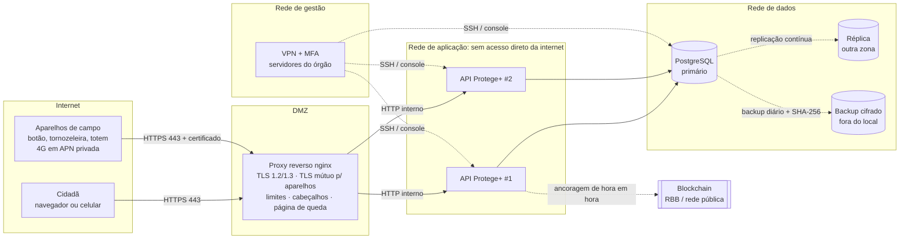

# Rede: a borda do Protege+

Parte 2 da Atividade Visão de Futuro: *Redes de Comunicação, segurança, resiliência e confiança*.

A pasta tem a configuração da borda de rede, que é o único ponto do sistema exposto à internet. Ela foi testada com requisições reais: **39 verificações, 0 falhas** ([`resultados/rede-20261027-213123.txt`](resultados/rede-20261027-213123.txt)). O painel completo também foi aberto por ela, em HTTPS, com as 10 abas e nenhuma violação da política de conteúdo ([`resultados/painel-pela-borda-20261027.txt`](resultados/painel-pela-borda-20261027.txt)).

## Topologia de referência



**Regra das setas:** cada camada só conversa com a vizinha. Um invasor que chegue ao proxy ainda não enxerga o banco. A administração entra só pela VPN, nunca pela internet aberta.

## O que foi implementado e testado

| Defesa | Onde | Pilar CIA | Verificação |
|---|---|---|---|
| HTTPS obrigatório (HTTP vira 301), TLS 1.2 e 1.3, TLS 1.1 recusado, troca de chaves ECDHE | `nginx/protege.conf` | C, I | 7 testes |
| HSTS, CSP, nosniff, X-Frame-Options, Referrer-Policy, versão do servidor escondida | idem | I | 6 testes |
| Só o front-end público sai: código, banco, chaves, console H2 e Swagger dão 404 | idem | C | 9 testes |
| **TLS mútuo:** cada aparelho tem certificado próprio, emitido pela AC de dispositivos. Sem ele, ou com certificado de outra AC, a requisição para no proxy. Com ele, a API ainda exige a chave `X-Device-Key`. | idem + `pki/` | C, I | 5 testes |
| IP real do cidadão no limite por origem e na trilha, mesmo quando ele forja `X-Forwarded-For` | proxy + `AuditoriaService` | I | 1 teste |
| CORS: o endereço público chama a API; site de terceiros não | API (`CORS_ORIGENS`) | C | 2 testes |
| Rajada de denúncias, JSON de 400 KB e arquivo de 7 MB barrados na borda; evidência de 1 MB passa | idem | D | 4 testes |
| API fora do ar: resposta 503 em JSON, em milissegundos, com os números 190 e 180 | idem | D | 2 testes |
| Conexão lenta de propósito (slowloris) derrubada em 10 s | idem | D | 1 teste |

### Achados desta parte, já corrigidos

1. **Atrás de um proxy, a trilha gravaria o IP do proxy para todo mundo.** O limite por origem já sabia ler o endereço repassado pelo proxy, mas a trilha de auditoria lia só a conexão. Agora as duas usam o mesmo critério, e um teste unitário cobre isso.
2. **`location ^~ /api/` engolia as regras específicas.** No nginx, o modificador `^~` impede que expressões regulares sejam avaliadas. Com ele, a regra de evidência (até 5 MB) e a de TLS mútuo nunca valiam: um aparelho sem certificado passava e uma foto de 1 MB seria recusada. O teste pegou os dois casos.
3. **Um `proxy_set_header` dentro da rota dos aparelhos apagava os herdados, inclusive o `Host`,** e o Tomcat respondia 400. A diretiva subiu para o nível do servidor.
4. **Login pela borda respondia 403 (CORS)** porque a origem pública não estava na lista. Em produção, `CORS_ORIGENS` recebe o domínio.

## Como rodar o teste

Funciona em Linux ou WSL, com `nginx`, `openssl`, `curl` e `python3` instalados.

```bash
# 1. A API, em outro terminal, com as duas variáveis da borda
#    (o pacote vem de: cd backend && mvn package -DskipTests, ou .\build.cmd package no Windows)
cd backend
PROTEGE_PROXY_CONFIAVEL=true CORS_ORIGENS=https://localhost:8443 java -jar target/protege-backend-1.0.0.jar

# 2. Os certificados (AC de servidores, AC de dispositivos, um por aparelho)
bash infra/pki/gerar-certificados.sh

# 3. O teste: sobe o nginx em 8088/8443, roda tudo e grava o relatório em infra/resultados/
bash infra/testar-rede.sh
```

No Windows, os certificados podem ser gerados no Git Bash. O resto do teste precisa do nginx, que é mais simples de rodar no WSL.

## Em produção

| Item | Demonstração | Produção |
|---|---|---|
| Certificado do site | AC interna (`pki/`) | AC pública ou ICP-Brasil, com renovação automática |
| Certificado dos aparelhos | AC interna, validade de 1 ano | AC interna do órgão em equipamento dedicado (HSM), com lista de revogação |
| Volume (DDoS) | Limites do nginx | Limites do nginx mais um serviço de mitigação na frente (CDN/WAF), porque o volume de um ataque grande satura o link antes de chegar ao proxy |
| Instâncias da API | 1 | 2 ou mais, em zonas diferentes; o proxy já tenta a outra (`proxy_next_upstream`) |
| Banco | H2 em arquivo | PostgreSQL com réplica contínua e backup cifrado fora do local |
| Acesso administrativo | Local | Só por VPN com MFA; console H2 e Swagger desligados (`PROTEGE_DEMO=false` já faz isso) |
